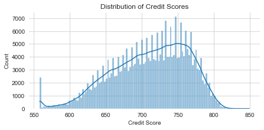
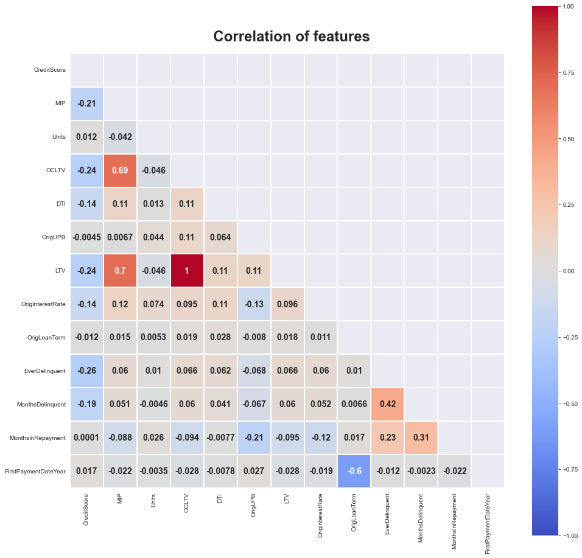
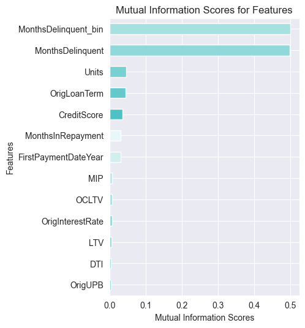
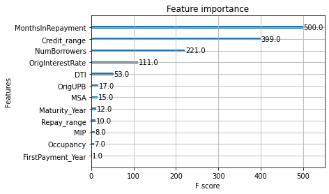

# Mortgage Prepayment Risk Prediction

An end-to-end machine learning project on Freddie Mac mortgage data. It covers cleaning, exploration and feature selection, then classification and regression models, and ends with a small Flask web app that serves the regression model.

The project was carried out by a team of interns at [Technocolabs Softwares Inc.](https://www.technocolabs.com/) in 2023.

<p align="center">
  
</p>

## The problem

Mortgage-backed securities (MBS) are bonds backed by bundles of home loans. When borrowers pay their loans back early, investors receive their principal sooner and stop earning interest on it. That is prepayment risk. The project uses loan-level data to estimate this risk for each loan.

## Data

`Datasets/LoanExport.csv` is a Freddie Mac loan-level extract: 291,451 loans and 28 columns. It has credit score, debt-to-income and loan-to-value ratios, interest rate, loan amount and term, property and borrower details, months in repayment and months delinquent. Most loans had their first payment in 1999. `Datasets/Variable Definitions.pdf` describes every column.

The other CSV files in `Datasets/` are outputs of the notebooks: the cleaned data and the feature sets used for modeling.

## Notebooks

| Notebook | What it does |
|---|---|
| `1. Improved First_Task - Data Preprocessing MBS Prepayment Risk` | Parses dates, turns placeholder values into missing values, imputes them, drops constant and ID columns, and groups servicers and states. |
| `2. Second Task - EDA` | Distributions, correlations, ANOVA against the target, k-means clustering and PCA. Adds credit score, loan-to-value and repayment ranges. |
| `3. Third Task - Feature Engineering` | Compares feature selection methods (PCA, correlation, mutual information, chi-squared, variance threshold) and saves the selected feature sets. |
| `4. Model Building - Classification` | Decision tree and XGBoost classifiers for `EverDelinquent`. |
| `4.1. Model Building with hyperparameters optimization - Classification` | Tunes XGBoost with Optuna and checks it with stratified k-fold. |
| `5. Regression Modeling with Pipeline` | Builds the prepayment target and trains the regression models, then saves the final scikit-learn pipeline to `XGBreg_pipeline.pkl`. |
| `5. Regression Modeling` | An earlier version of the regression notebook. |
| `Final Submission - Whole Group Work` | The team's combined notebook, from preprocessing to tuned models. |

All notebooks are in `Notebooks/`.

| Credit scores | Correlations |
|---|---|
|  |  |
| **Mutual information with delinquency** | **XGBoost feature importance** |
|  |  |

Months delinquent is by far the most informative feature for the delinquency target. Among the other features, the XGBoost classifier relies most on months in repayment, credit score range and number of borrowers.

## Results

Classification of `EverDelinquent`, on a held-out test split:

| Model | Accuracy | F1 (delinquent class) |
|---|---|---|
| Decision tree | 0.812 | 0.23 |
| XGBoost | 0.812 | 0.22 |
| XGBoost tuned with Optuna | 0.814 | |

For reference, 80.2% of the loans were never delinquent, so always predicting "not delinquent" already gives 0.802 accuracy. With class weighting, XGBoost reached a cross-validated ROC-AUC of about 0.71.

Regression of the prepayment risk ratio (PPR). PPR is computed from the loan amount, interest rate, term and months in repayment, through monthly payments, expected and actual principal paid, and outstanding balance:

| Model | R² |
|---|---|
| Decision tree | 0.9994 |
| XGBoost | 0.9997 |
| Saved pipeline (imputation, one-hot encoding, scaling, PCA with 15 components, XGBoost) | 0.673 |

The near-perfect scores come from the fact that PPR is a formula of input features the models also see. The pipeline compresses those features with PCA, so its lower score reflects the model more realistically.

## Web app

`app.py` is a Flask app that loads `XGBreg_pipeline.pkl` and predicts PPR from a form with 19 loan fields (state, property type, occupancy, loan purpose, credit and loan-to-value ranges, loan amount, interest rate, term, DTI and others).

The saved model only loads with the library versions it was built with, which need Python 3.8 to 3.10:

```bash
pip install flask "pandas<2" "numpy<1.24" scikit-learn==1.0.2 xgboost==2.0.0
python app.py
```

Then open http://127.0.0.1:5000.

## Run the notebooks

The notebooks need `pandas numpy matplotlib seaborn plotly scipy scikit-learn xgboost optuna kneed skfeature-chappers`. They were run with Python 3.7 and 3.9. Most of them read the CSV files from the current folder, so copy the files you need from `Datasets/` next to the notebook or change the paths.

## License

[Apache-2.0](LICENSE).
